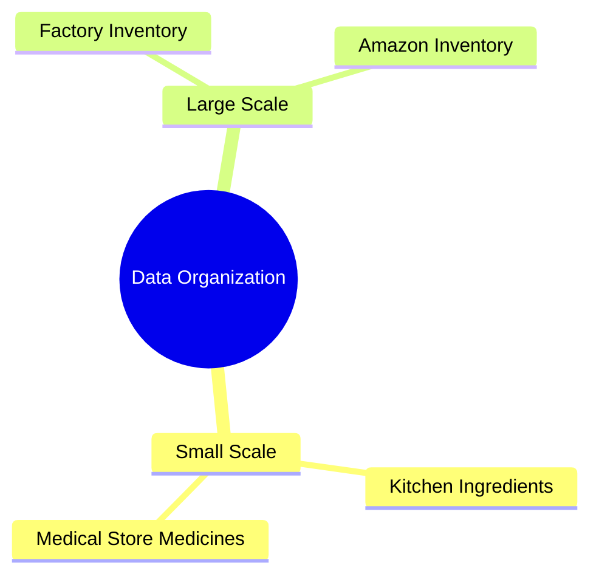

### GATE Exam Preparation Course

- **[Instructor Background]** The instructor states that he has 15 years of experience teaching 10 GATE course subjects to thousands of students through online and offline classes at major coaching institutes in India.
- **[Course Structure]** The course is presented as a structured GATE preparation program with time management.
    - It includes concept videos, previous-year question solutions, notes, and an exam roadmap.
    - The instructor says the course is designed from the absolute basics, uses real-life examples, and requires no prior knowledge.
- **[Syllabus and Exam Strategy]** The instructor says the course is designed according to the GATE syllabus and claims it will cover 100% of that syllabus.
    - More attention is given to topics where GATE questions are asked more frequently.
    - Shortcut tricks and techniques are included to help students solve exam questions in less time.

### Importance of Data Structures and Algorithms

- **[Conceptual Clarity]** Before jumping directly into arrays, stacks, or queues, the instructor first explains why Data Structures and Algorithms are important.
    - Students study roughly 40 subjects over a four-year degree, but the instructor singles out Data Structures and Algorithms as two subjects that require especially strong conceptual clarity.
    - He says these subjects can support a person's professional life over the long term.
- **[Depth of Study]** The instructor advises studying these subjects thoroughly by understanding their fundamentals in detail and depth, rather than treating them superficially.

### Purpose of Studying Data Structures

- The instructor says the goal is not merely to memorize how insertion and deletion algorithms work in individual data structures; he describes that as the smaller task.
- **[Broader Objective]** Students should first understand what Computer Science and IT engineers do and how Data Structures and Algorithms contribute to that work.

### Idea of Computer Science and Efficient Programs

- Computer Science is described as solving problems by designing algorithms that can be converted into efficient programs.
    - The key challenge is optimizing **time** and **memory**.
    - A Computer Science engineer solves problems brought by customers or clients by designing algorithms, rather than physically or mechanically solving those problems.
- **[The Formula for Efficiency]** The slide presents an efficient program as requiring both data organization and a procedure for solving the problem:

$$\text{Efficient Program} = \text{Data Structure} + \text{Algorithm}$$

### Understanding and Evaluating Algorithms

- **[Definition of an Algorithm]** An algorithm is a systematic, step-by-step procedure that can be converted into a computer program using a programming language and executed on a computer to solve a problem.
- **[Comparing Algorithms]** Different algorithms can solve the same problem, so criteria are needed to decide which one is better.
    - **Time** describes how quickly the algorithm executes.
    - **Memory** describes how much space it requires.

### Prioritizing Time over Memory

- **[Key Insight]** The instructor identifies time as the most important of the two evaluation criteria.
    - He argues that modern devices have ample memory and that good internet connectivity allows data to be stored in the cloud, making space less of a problem in his explanation.
    - Reducing the time required to solve a problem remains the central development goal.
- **[Defining Efficiency]** A Computer Science engineer should not merely write a program; the goal is to write an efficient program that solves the problem in the minimum possible time.

### Code Length versus Execution Time

- **[Common Misconception]** Beginners may compare a 10-line solution with a 4-line solution and assume that the shorter solution makes them a better programmer.
- The instructor says programming quality is not determined by how short the code is; what matters is how quickly the program executes.
- **[The Two Pillars]** The instructor identifies two elements for achieving efficient execution:
    - **Data Structures**: The way data is organized.
    - **Algorithms**: The procedure used to solve the problem with that organized data.

### Data Structures and Data Organization

- **[Definition]** A data structure is the way data is organized in a computer's memory.
- The instructor mentions arrays, stacks, queues, linked lists, and trees as examples of structures that will be covered.
- **[Real-World Analogies]** The instructor uses everyday and organizational examples to explain why deliberate data organization matters:
    - A kitchen organizes spice containers, ingredients, food, lentils, and vegetables.
    - A medical-store pharmacist organizes medicines so a required item can be found quickly—for example, a particular strip in a specific slot.
    - A large factory or an organization such as Amazon must also arrange its items and inventory systematically.

### Why Organization and Use Both Matter

- **[Importance of Organization]** Poorly arranged items may be difficult to find even when they are physically present. The instructor connects this to computer memory: poor organization can create problems over the long term, while correct organization helps avoid them.
- **[Organization Is Not Enough]** The instructor explains that arranging data correctly is only one part of the task; it must also be used toward the intended objective.
    - He compares this with a hostel student who keeps a room, table, and almirah tidy but does not study. Organization alone does not achieve the objective function.
    - The two requirements are therefore (1) organizing data in computer memory and (2) knowing how to use that organized data.
- **[Beginner Difficulty]** The instructor observes that students who begin programming directly may find it difficult and become confused about what they are doing and why.
