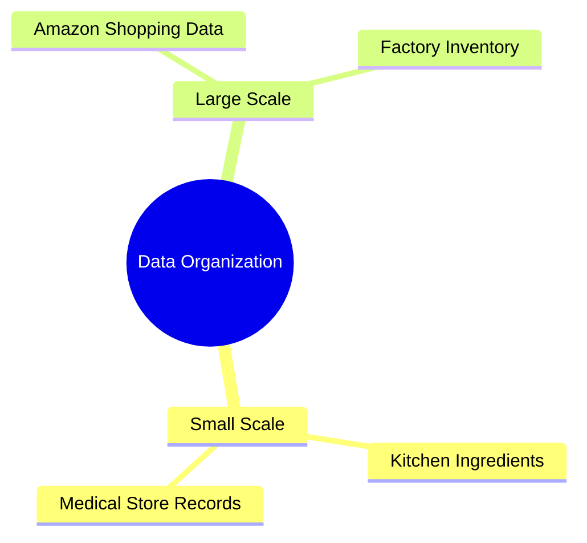
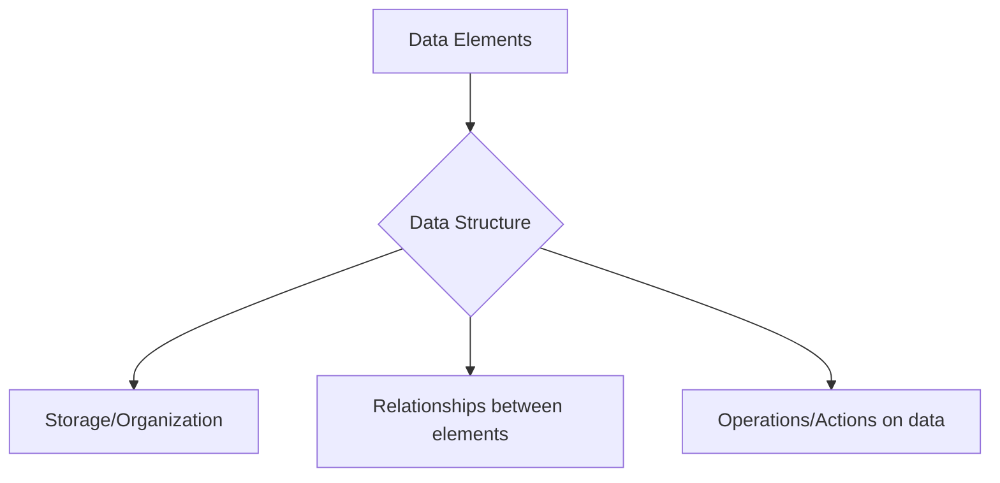
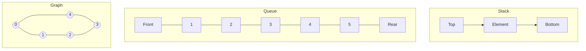

### GATE Exam Preparation Course

- Designed specifically according to the GATE exam syllabus
    - No prior knowledge is required to start this course
    - Guarantees 100% coverage of the GATE syllabus
- **[Teaching Strategy]** To optimize exam performance, the course focuses on:
    - Topics that frequently appear in the GATE exam
    - Shortcut tricks and techniques to solve questions more quickly
- **10 Core Subjects Covered**
    - OS (Operating Systems)
    - DBMS (Database Management Systems)
    - CN (Computer Networks)
    - DIGITAL (Digital Logic)
    - COA (Computer Organization and Architecture)
    - TOC (Theory of Computation)
    - DM (Discrete Mathematics)
    - COMPILER (Compiler Design)
    - DS (Data Structures)
    - ALGORITHM

### Idea of Computer Science

- Computer science is about solving problems by designing algorithms that can be converted into efficient programs
    - The key challenge is optimizing for **time** and **memory**
- **[The formula for efficiency]** To write an efficient program, both of the following are required:
    - **Data Structures**: The way you organize data
    - **Algorithms**: The process to solve the problem using organized data

$$\text{Efficient Program} = \text{Data Structure} + \text{Algorithm}$$

### Understanding Algorithms

- An algorithm is a step-by-step procedure used in a programming language to solve a problem
- **[Criteria for a "good" algorithm]** To decide which algorithm is better, two main factors are considered:
    - **Time**: How quickly the procedure executes
    - **Memory**: How much space the procedure requires

### Prioritizing Time over Memory

- In modern computing, **time** is a more critical constraint than **memory**
    - Devices have ample memory
    - Cloud storage provides massive space availability
- **[Defining Efficiency]** For a computer science engineer, efficiency means solving a problem in the least amount of time possible
- **[Common Misconception]** Programming quality is not determined by the number of lines of code written
    - A programmer might think using more lines makes them "better"
    - In reality, the quality is judged by how quickly the program executes
- **The Two Pillars of Optimization**
    - To achieve execution speed, one must focus on:
        - **Data Structures**: How data is organized
        - **Algorithms**: The process used to solve the problem

### Data Structures

- The way you organize data in computer memory
- **[The importance of organization]** Without proper organization, retrieving or managing data becomes problematic
    - If data is unorganized, you cannot find what you need efficiently
    - Effective organization is required for everything from small-scale tasks to massive operations
- **Real-world analogies for data organization**
    - A kitchen: organizing ingredients and food
    - A medical store: organizing medicines and patient information
    - A large corporation (e.g., Amazon): managing massive amounts of consumer and inventory data



### The Formula for Efficient Programming

- To write an efficient program, you must master two components:
    - **Data Structures**: The way you organize data in computer memory
    - **Algorithms**: The process used to solve the problem using organized data
- **[The core equation]**
    - `Efficient Program = Data Structure + Algorithm`
- **[Language Independence]**
    - This principle applies to any programming language, whether you are coding in C, Java, or Python
    - Efficiency is driven by how you handle data organization and execution logic within the system, not just the syntax of the language

### What is a Data Structure?

- A particular way of organizing data in computer memory
- **[The goal of organization]** To ensure memory is used efficiently in two ways:
    - **Time**: Reducing the time required for operations
    - **Space**: Reducing the amount of memory used
- It is a logical relationship existing between individual elements of data
    - It considers not just the elements themselves, but also their relationship to each other
- **Data structures specify four key components**:
    - Organization of data
    - Accessing methods
    - Degree of association
    - Processing methods

### The Essence of Data Structures

- It is not just about the act of storing data
    - A data structure must account for **what we do with the data**
    - It must define the **relationships** between the elements being stored
- **[The Supermarket Analogy]**
    - In a shopping mall or supermarket, organization is key to success
    - Items are placed on specific shelves so they can be easily located and retrieved
    - If items were scattered without a logical relationship or organization, finding them would be inefficient



### Managing Data through Structure

- A structured system allows for the efficient management of various constraints:
    - **Space**: Controlling how much memory is consumed
    - **Time**: Controlling how quickly operations are performed
    - **Relationships**: Managing how different data elements connect to one another
    - **Events**: Handling other operations or interactions within the data structure
- **[The importance of system awareness]** To use a data structure effectively, one must understand the entire system to know how to traverse and interact with the data contained within it

### The Four Components of a Data Structure

To fully understand or create a specific data structure, four key elements must be defined:

- **Organization of data**
    - Determining how the data is arranged within the structure
- **Accessing methods**
    - Defining the ways in which the data can be reached or retrieved
- **Degree of association**
    - **[Definition]** This refers to the complexity of the structure and how elements are linked
    - **Example**: In a linked list, this involves how many nodes are linked together
- **Processing methods**
    - The specific operations that can be performed on the data
    - **Example**: How to perform an `insert` operation in a linked list

> Understanding these four components is a fundamental concept; without this foundation, it is difficult to achieve a solid grasp of the entire subject.

### Popular Industry Data Structures

Various data structures are used in the industry, each with unique organizational rules and operational methods:

- **Stack**
    - A restricted area where both insertion and deletion occur at the same end
    - **Operations**:
        - **Push**: The process of insertion
        - **Pop**: The process of deletion
- **Queue**
    - Utilizes two pointers to manage data flow
        - **Front pointer**: Used for deletion
        - **Rear pointer**: Used for insertion
- **Graph**
    - A structure consisting of vertices and edges
    - Can be categorized by several properties:
        - **Weight**: Weighted vs. non-weighted
        - **Direction**: Directed vs. undirected
- **Tree**
    - A hierarchical structure (e.g., Binary Tree)
- **Linked List**
    - A linear collection of elements where each element points to the next



### The Impact of Data Structures on Programs

- Data structures influence both the structural and functional aspects of a program
- The choice of data structure is a crucial factor in overall program design and efficiency

#### Specialized Data Structures for Different Applications

- **Relational Databases**
    - Often utilize **B-tree indexes** to ensure efficient data retrieval
- **Compiler Implementations**
    - Commonly rely on **hash tables** to facilitate fast identifier lookups

#### Strategic Selection Based on Requirements

- Choosing the right structure depends on the specific problem type and data characteristics:
    - **Read-only systems**: If the system is read-only and lacks a need for flexibility, certain structures may be exceptionally fast
    - **Search problems**: May require specific structures like B-trees
    - **Sorting problems**: **Heaps** are a suitable choice for sorting tasks

> If you provide the right problem with the right data structure, you can do wonders with it.

### Primitive and Non-Primitive Data Structures

- **Primitive Data Structures**
    - **Definition**: Predefined by the system and directly operated upon by machine instructions
    - **Examples**: `char`, `int`, `float`, `double`
    - **Operations**: The set of operations (like addition, subtraction) is predefined and can be directly executed by the system
- **Non-Primitive Data Structures**
    - Used when primitive data structures are insufficient
    - **Derived Data Structures**
        - **Definition**: Built using primitive data types, but with a more complex structure
        - **Examples**: Arrays (e.g., array of `int`, array of `char`)
        - **Operations**: Predefined operations, similar to primitives, are available for manipulation
    - **User-Defined Data Structures**
        - **Definition**: Created by the user using primitive and derived types, with custom structures and operations
        - **Examples**: Linked Lists, Trees, Stacks, Queues
        - **Operations**: The user defines the operations to perform on these structures using constructs like structures or classes

#### Other Classifications

- **Homogenous vs. Heterogeneous**
- **Linear vs. Non-Linear**

### The Necessity of Data Structures

- **The Problem: Manual Memory Management**
    - Without data structures, a programmer would have to start from scratch for every task
    - This would involve manually defining:
        - Memory size (e.g., reserving exactly 2 bytes)
        - Allowed operations (e.g., which specific mathematical or logical actions are permitted)
    - This process is highly inefficient and prone to confusion
- **The Analogy: Building a House**
    - Just as a house cannot be built without specific materials like cement, iron bars, and furniture, complex software cannot be built without organized data structures
- **Foundational Requirements**
    - Efficiently organizing memory relies on a fundamental understanding of:
    - Computers
    - Compilers
    - Programming languages

### Linear vs. Non-Linear Data Structures

| Feature | Linear Data Structure |
| --- | --- |
| Arrangement | Data elements are arranged in a linear order |
| Connectivity | Each element is attached to its previous and next adjacent element |
| Complexity | Single level is involved; implementation is easy |
| Traversal | Elements can be traversed in a single run only |
| Examples | Array, Stack, Queue, Linked List |

| Feature | Non-Linear Data Structure |
| --- | --- |
| Arrangement | Data elements are attached in a hierarchical manner |
| Complexity | Multiple levels are involved; implementation is complex |
| Traversal | Elements cannot be traversed in a single run only |
| Examples | Trees, Graphs |

### Traversal and Implementation Complexity

- **Non-Linear Traversal**
    - Unlike linear structures that can be traversed in a single run, non-linear structures use different mechanisms and patterns due to their complex paths
    - **Examples of non-linear traversal methods**:
        - For Graphs: Depth First Search (DFS), A\* algorithm
        - For Trees: In-order, Pre-order, Post-order, and Level-order traversals
- **Implementation Difficulty**
    - Linear structures are relatively easy to understand and implement
    - Non-linear structures involve multiple levels (depth/height) and are more complex to implement

### Homogeneous vs. Heterogeneous Data Structures

- **Homogeneous Data**
    - These structures store elements of the \*\*same type
    - **Example**: An array where all elements share the same data type, such as all integers or all floats
- **Heterogeneous Data**
    - These structures can hold elements of \*\*different types
    - A single structure might store integers, floats, and characters together
    - **Examples**: Structures and unions

### Heterogeneous Examples

- While homogeneous structures require all elements to be of the same type, heterogeneous structures allow for variety:
    - **Structures**: Specifically designed to group different data types.
    - **Linked Lists**: Can be implemented to hold different types of data across nodes.

### Transition to Arrays

- The upcoming study of arrays will focus on the conceptual depth required for competitive exams (such as GATE, NET, PSU, ISRO, DRDO, and NTPC) rather than mere university-level submissions.
- **Objective**: To master the underlying concepts so that both technical and conceptual challenges in high-standard examinations can be successfully navigated.

### Arrays

- **Definition**
    - An array is a data structure that stores a collection of elements of the same type
    - These elements are stored at **contiguous memory locations** (placed back-to-back in sequence)
    - Elements can be accessed using an \*\*index
- **Key Characteristics**
    - **Homogeneous**: Every data element in the array must be of the same type
    - **Contiguous Storage**: Data is kept in a continuous block in memory
    - **Index-based Access**: Provides a way to point to and retrieve specific elements

### Array Declaration in C

To declare an array, you specify the data type, the name, and the size in square brackets.

```c
int num[5];
```

- **Breakdown of Syntax**:
    - `int`: Specifies that the array will store integer types
    - `num`: The name of the array
    - `[5]`: The size of the array, indicating it contains 5 elements

**[Note on Size]**: The size is fixed upon declaration; you cannot increase or decrease it dynamically using this standard syntax.

#### Visual Representation of `int num[5]`

| Index | num[0] | num[1] | num[2] | num[3] | num[4] |
| --- | --- | --- | --- | --- | --- |
| Value | 2 | 8 | 7 | 6 | 0 |
| Mapping | Element 1 | Element 2 | Element 3 | Element 4 | Element 5 |

### Array Indexing

- In computer science, indexing typically starts at **0** rather than 1
    - The first element is located at index `0`
    - The second element is at index `1`, and so on
- **[Using Indexing]** It is the mechanism used to perform operations on specific elements:
    - **Read**: Retrieving the value at a specific index
    - **Write/Modify**: Changing the value stored at a specific index

#### Example: Accessing `int num[5]`

Using the array from the previous example, we can access elements by their index number:

| Index | num[0] | num[1] | num[2] | num[3] | num[4] |
| --- | --- | --- | --- | --- | --- |
| Value | 2 | 8 | 7 | 6 | 0 |
| Mapping | Element 1 | Element 2 | Element 3 | Element 4 | Element 5 |

- **Accessing a value**: To get the value at index `3`, you would reference `num[3]`, which returns `6`.

### Declaration and Memory in C

To declare an array in C, the syntax follows a specific order:

```c
datatype arrayName[arraySize];
```

- **Syntax Components**:
    - `datatype`: The type of data the array will hold (e.g., `int`)
    - `arrayName`: The identifier used to refer to the array
    - `[arraySize]`: The fixed number of elements the array can contain
- **Memory Behavior in C**:
    - When an array is declared, memory is allocated for its elements
    - **[Warning]**: The initial values of these elements remain **undefined** or contain **garbage values** until they are explicitly initialized
    - Because the size is fixed upon declaration and cannot be altered, it is crucial to plan array usage according to these size constraints.

### Declaration vs. Initialization

- **Declaration**: Reserving space in memory for the array
    - The size is fixed upon declaration and cannot be changed later
    - **[Warning]**: If not explicitly initialized, the array contains **garbage values** (unpredictable, random data)
- **Initialization**: Assigning specific values to the reserved memory locations

### Declaration with Initialization in C

To declare an array and assign values at the same time, use the following syntax:

```c
dataType arrayName[arraySize] = {value1, value2, ..., valueN};
```

#### Example: Initializing an array of size 5

```c
int myArray[5] = {1, 2, 3, 4, 5};
```

| Index | 0 | 1 | 2 | 3 | 4 |
| --- | --- | --- | --- | --- | --- |
| Value | 1 | 2 | 3 | 4 | 5 |

### Modifying Array Elements

You can change the value of a specific element by referencing its index:

- **To change the third element to -1**:
        - Use index `2` (since indexing starts at 0)
        - `myArray[2] = -1;`
- **To change the fifth element to 0**:
        - Use index `4`
        - `myArray[4] = 0;`

### Advantages of Arrays

- **Efficient Storage and Access**:
    - Elements are stored in contiguous memory locations
    - This allows for fast retrieval using indices
- **Random Access**:
    - Provides constant-time access to any element using its index
    - Makes operations like reading or updating an element extremely efficient
- **Ease of Use**:
    - Simple to understand and implement
    - Compatible with common sorting and searching algorithms like binary search

### Disadvantages of Arrays

- **Fixed Size**:
    - Once created, the size of an array cannot be changed
    - This can be restrictive when working with dynamic data where the size may increase or decrease
- **Lack of Flexibility for Insertion/Deletion**:
    - Arrays do not natively support efficient insertion or deletion of elements
    - These operations may require shifting elements, which can be time-consuming
- **Homogeneous Elements**:
    - Arrays can only store elements of the same data type
    - This limits flexibility in scenarios that require handling multiple types of data

### Array Access Mechanics and Fragmentation

- **High-Speed Access via Base Address**:
    - Because elements are stored back-to-back in contiguous memory, there is no need for extra pointers to maintain the sequence (unlike linked structures that require "hopping" from node to node).
    - This allows for extremely fast retrieval from large datasets because the exact memory location can be calculated using a formula derived from the **base address** and the specific index.
- **Memory Fragmentation**:
    - Due to the fixed-size nature of arrays, they can suffer from both **internal** and **external fragmentation**.
    - **Internal Fragmentation Example**: If you declare an array of size 10 but only store 6 elements, the 4 unused slots represent wasted memory space within the allocated block.

### Detailed Fragmentation and Operational Costs

- **Fragmentation Nuances**:
    - **Internal Fragmentation**: Occurs when memory is wasted *inside* the allocated block (e.g., allocating space for 10 elements but only utilizing 6).
    - **External Fragmentation**: Occurs when the required size exceeds the initial allocation at runtime (e.g., needing 15 slots when only 10 were declared). Even if the system has enough total free memory, the array cannot expand unless that memory is available in a single, **continuous** block.
- **Operational Complexity vs. Linked Lists**:
    - **The Cost of Shifting**: In an array, inserting an element at a specific position (e.g., the third position) requires swapping or moving all subsequent elements one step over.
    - **Comparison**: Unlike linked lists, where you can simply adjust pointers to include a new node, the manual shifting required in arrays makes frequent insertions/deletions impractical and computationally expensive.

### Limitations of Homogeneous Elements

- Because arrays are homogeneous, they cannot store multiple data types within a single structure
    - For example, you cannot store a mix of integers, floats, and characters in one array
    - To handle different types of metadata (like a book's page count as an integer and its weight as a float), you would need a different structure, such as a 2D matrix or a custom structure

### Types of Indexing in Arrays

- Indexing determines which element we start numbering from to access data
- **Zero-based indexing**:
        - The first element is indexed by the subscript 0
        - This is the default behavior in most programming languages
- **One-based indexing**:
        - The first element is indexed by the subscript 1
- **n-based indexing**:
        - The base index can be freely chosen (e.g., starting from any value $n$)
        - Many languages allow for negative index values or using other scalar data types (like characters or enumerations) as an array index